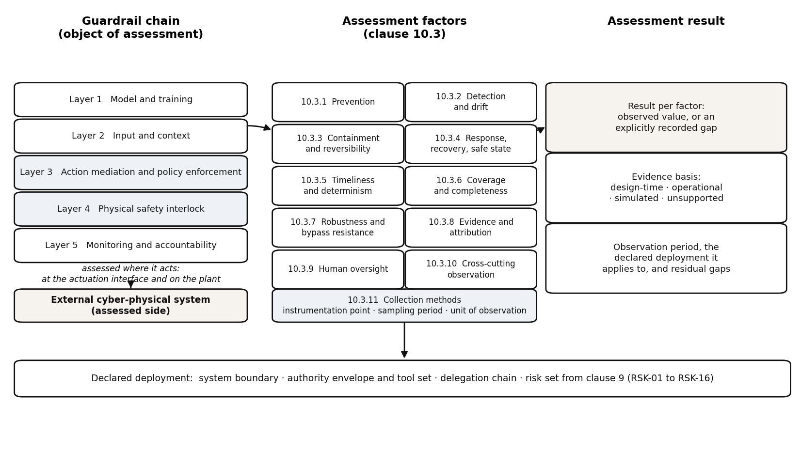

Assessment factors and collection methods
=========================================

What the factors assess
-----------------------

The factors fall into the ten categories set out in 11 to 11 below. Each factor is assessed either on the external cyber-physical system or on the guardrail chain, and the assessment states which side of the boundary the observation belongs to. Each factor is expressed as something observed over a period of operation rather than as a single measurement, so that the assessment reflects behaviour across the range of conditions the deployment encounters, including conditions that arise infrequently. A factor may be unobservable for several reasons: the necessary instrumentation is absent, the relevant events did not occur during the observation period, or the evidence is held by a party outside the assessment. In such a case the assessment records the gap explicitly rather than treating the factor as satisfied. An unobserved factor is reported as unobserved, and effectiveness is not assumed in its place. Figure 1 shows how the factor categories relate to the guardrail chain, to the evidence that can be collected and to the assessment result.

    Figure 1 - Assessment of guardrail effectiveness: the guardrail chain, the assessment factors and the assessment result

Prevention factors (AF-01)
--------------------------

The prevention factors assess how well the guardrail chain keeps the agent inside its mandate before any action reaches the plant, and thus how much adverse behaviour is stopped at the point of action mediation rather than later. The concrete observables include the proportion of proposed actions that fall outside the declared authority envelope and are refused or modified. They also include the rate at which tool invocations are rejected because the tool is not in the permitted set or its parameters do not satisfy the action policy, the frequency with which scope escalation and confused-deputy patterns are blocked, and the incidence of poisoned context or memory reaching an action decision without being filtered. A weak result is refusals concentrated on obviously malformed requests while actions that are plausible but out of mandate go through, or an agent that repeatedly probes the boundary. A strong result shows refusals distributed across the range of out-of-mandate attempts, with the agent's accepted actions staying within the envelope across varying conditions. The category bears on RSK risks of goal hijacking, tool-name and parameter confusion, confused-deputy and scope escalation, memory and vector-store poisoning, and indirect prompt injection through tool results, retrieved documents and email.

One limitation is that refusal counts alone do not distinguish a correct refusal from over-blocking, so prevention is judged alongside the operational consequences of the denied actions.

A second limitation is that the prevention factors observe the guardrail chain at the point of decision, not the provenance of the intent behind an action. An action that is within the envelope but was induced by a compromised input therefore appears as a permitted action. The observables therefore include the consistency of accepted actions with the declared task and the frequency with which accepted actions are subsequently reversed or flagged by monitoring. A weak result shows accepted actions that are individually in-policy but collectively incoherent with the agent's stated goal, or shows monitoring reversing a noticeable share of accepted actions. A strong result shows accepted actions remaining coherent with the declared task over the observation period, with reversals attributable to changing plant conditions rather than to mistaken authorisation. The category bears on the same RSK risks as the preceding paragraph and additionally on exfiltration through tool channels, since a permitted tool call can carry data outward while remaining within its nominal parameters. The limitation is that coherence judgements depend on the declared task being stated precisely enough to be checked. These correspond to RSK-01, RSK-02, RSK-05, RSK-06, RSK-10 and RSK-13 in clause 10.

Detection and drift factors (AF-02)
-----------------------------------

The detection and drift factors assess how well the guardrail chain notices that the agent, its context or its environment has moved away from the conditions under which the deployment was assessed, and how promptly that movement is surfaced. The concrete observables include the time between the onset of a deviation and its first appearance in the evidence record, and the proportion of adverse events that the chain detects rather than an external party reporting them or harm being discovered afterwards. They also include the rate of change in the agent's action distribution and tool-use profile relative to its baseline, the incidence of drift in retrieved context or memory content, and the volume of alerts later confirmed as genuine. A weak result is deviations detected only after they have produced effects at the plant, or a detection capability swamped by unconfirmed alerts. A strong result shows deviations surfacing while they are still confined to the agentic system, with confirmed detections forming a usable share of the total. The category bears on RSK risks of goal hijacking, memory and vector-store poisoning, tool and plugin supply-chain compromise, and denial of service against the agent loop.

One limitation is that detection of drift depends on a baseline that is itself valid only for the conditions under which it was established.

A further limitation is that detection quality is bounded by what the evidence record captures, so an event that leaves no trace in the record cannot be assessed as detected or undetected. The observables therefore include the completeness of the evidence record with respect to actions, tool calls, context changes and policy decisions, and the fraction of the observation period for which the record is continuous. A weak result shows gaps in the record coinciding with the periods of greatest deviation, or shows detection claims that cannot be traced to recorded evidence. A strong result shows a record that is continuous across the observation period and sufficient to reconstruct the sequence leading to each detected event. The category bears on the same RSK risks as the preceding paragraph and additionally on exfiltration through tool channels, where the outward movement may be visible only in the pattern of tool calls over time. The limitation is that a complete record establishes only that the data were captured, not that they were reviewed or acted upon. These correspond to RSK-01, RSK-06, RSK-07, RSK-12 and RSK-13 in clause 10.

Containment and reversibility factors (AF-03)
---------------------------------------------

The containment and reversibility factors assess how well the guardrail chain limits the extent of an adverse event once it has begun, and how far the effects of that event can be undone. The concrete observables include the number of plant components or external systems affected by an event before it is stopped, and the time from the first effect to the restoration of a bounded state. They also include the proportion of actions taken during an event that can be reversed through the available rollback or compensating mechanisms, the degree to which the agent's access to tools and data can be withdrawn while the event is in progress, and the extent to which effects spread across delegation boundaries to other agents. A weak result shows effects spreading beyond the subsystem in which they began, or shows a large share of actions that cannot be undone and are compensated instead. A strong result shows events remaining within the subsystem of origin, with the majority of affected actions reversible or compensable within the operational cycle. The category bears on RSK risks of scope escalation, exfiltration through tool channels, denial of service against the agent loop, and physical consequence when a hijacked plan reaches an actuator.

One limitation is that containment of an event in the digital domain does not by itself establish that the physical effects have ceased.

A second limitation is that reversibility is a property of the external cyber-physical system as much as of the guardrail chain, so an assessment of this category can be constrained by plant design that predates the agentic deployment. The observables therefore include the availability of a defined safe state for each actuated subsystem, the time required to reach that safe state, the fraction of actions for which a compensating action exists, and the record of whether compensating actions were in fact available and effective during past events. A weak result shows actuated subsystems for which no safe state is defined, or shows compensating actions that were unavailable when needed. A strong result shows every actuated subsystem with a defined and reachable safe state and with compensating actions that were available and effective when exercised. The category bears on the same RSK risks as the preceding paragraph and additionally on confused-deputy and scope escalation, where the extent of containment depends on the authority that was delegated. The limitation is that this category assesses the capability to contain and reverse, not the decision to invoke it. These correspond to RSK-04, RSK-05, RSK-10 and RSK-13 in clause 10.

Response, recovery and safe-state factors (AF-04)
-------------------------------------------------

The response, recovery and safe-state factors assess how well the guardrail chain and the surrounding operational arrangements return the cyber-physical system to a known-good condition after an adverse event, and how reliably the safe state is entered when the agentic layer is unable to continue within its mandate. The concrete observables include the time from event detection to the start of a response, and from there to the restoration of normal operation. They also include the share of incidents after which the plant returns to its pre-event condition without residual degradation, the number of occasions on which the fail-closed default or the physical safety interlock was invoked, and the completeness of the post-incident record used to establish what happened. A weak result shows recovery that depends on manual intervention outside the control-loop deadline, or shows residual degradation that persists across subsequent operating cycles. A strong result shows a response that is initiated promptly, a recovery that restores the pre-event condition, and safe-state transitions that occur when required and leave the plant in a defined condition. The category bears on RSK risks of denial of service against the agent loop, physical consequence when a hijacked plan reaches an actuator, and tool and plugin supply-chain compromise, where recovery may require the replacement of a compromised component.

One limitation is that a small number of invocations of the safe state provides little evidence about its reliability under the conditions that would demand it.

A second limitation is that recovery is assessed against the pre-event condition, which may itself have been degraded in ways that the assessment does not detect. The observables therefore include the stability of the restored condition over subsequent operation, the frequency with which recovery introduces new deviations, and the extent to which the post-incident record supports a determination of the event's cause and extent. A weak result shows repeated recovery from the same class of event without change to the guardrail chain, or shows a record insufficient to establish why the event occurred. A strong result shows recovery followed by stable operation and a record that supports a determination of cause and a change to the chain where one is needed. The category bears on the same RSK risks as the preceding paragraph and additionally on memory and vector-store poisoning, where recovery can require the restoration of context and stored state as well as plant condition. The limitation is that this category assesses restoration of function and not the adequacy of the response to the underlying cause. These correspond to RSK-04, RSK-06 and RSK-12 in clause 10.

Timeliness and determinism factors (AF-05)
------------------------------------------

The timeliness and determinism factors assess whether the guardrail chain acts within the time available and whether its behaviour is repeatable under the same conditions, since a control that is correct but late, or correct on one occasion and not on another, provides limited protection at the physical boundary. The concrete observables include the distribution of the time from action proposal to enforcement decision relative to the control-loop deadline, and the proportion of enforcement decisions that complete within it. They also include the variation in decision outcomes and latency across repeated presentations of the same input, the time the physical safety interlock takes to bring the plant to a safe state, and the rate at which the chain falls back to its fail-closed default when a decision cannot be completed. A weak result shows latency that approaches or exceeds the deadline under load, or shows outcomes that differ across repeated presentations of equivalent inputs. A strong result shows decisions completing within the deadline with margin across the range of observed load, outcomes that are consistent for equivalent inputs, and safe-state transitions that occur within the time the plant requires. The category bears on RSK risks of denial of service against the agent loop, physical consequence when a hijacked plan reaches an actuator, and tool-name and parameter confusion, where a decision that is late is equivalent to no decision.

One limitation is that measurements taken in one operating regime do not establish behaviour in another, so the observation period covers the regimes the deployment encounters.

A second limitation is that determinism of the enforcement point does not extend to the learned components that may inform it, so the assessment distinguishes decisions taken by deterministic enforcement from decisions taken by learned adjudicators. The observables therefore include the share of enforcement decisions taken by deterministic mechanisms, the consistency of learned adjudicators across equivalent inputs, the frequency with which a learned adjudicator is overridden by a deterministic rule, and the behaviour of the chain when a learned component is unavailable or returns an out-of-distribution result. A weak result shows reliance on a learned adjudicator for decisions that the control-loop deadline requires to be deterministic, or shows inconsistent behaviour when a learned component is unavailable. A strong result shows deterministic mechanisms carrying the decisions that the deadline governs, with learned components confined to advisory or non-deadline roles. The category bears on the same RSK risks as the preceding paragraph and additionally on indirect prompt injection through tool results, retrieved documents and email, where the injected input can vary while the required decision remains the same. The limitation is that consistency across equivalent inputs is difficult to establish for inputs whose equivalence is itself a judgement. These correspond to RSK-01, RSK-02 and RSK-04 in clause 10.

Coverage and completeness factors (AF-06)
-----------------------------------------

This category assesses how far a guardrail chain covers the full range of actions, tools, data flows and delegation paths that the agent can actually reach in the deployed cyber-physical system, and not only those foreseen at design time. Coverage is judged against the mandate and the declared allowed-action envelope, and it bears directly on goal hijacking, confused-deputy and scope escalation, tool-name and parameter confusion, and exfiltration through tool channels (RSK-02, RSK-03, RSK-04, RSK-05, RSK-09, RSK-11, RSK-16). The observables here are the proportion of enumerated tools, APIs and endpoints that map to an explicit policy decision point, the number of action classes with no corresponding guardrail or interlock, the count of delegation paths whose authority can be traced end to end, and the fraction of data egress routes that are mediated. A weak result shows substantial parts of the reachable action surface unmediated, orphaned delegation links, or egress paths that bypass the enforcement point; a strong result shows a near-complete mapping in which every reachable action and data flow has an identified controlling layer, with residual gaps explicitly recorded rather than silently absent.

The first dimension of coverage is spatial completeness: whether every reachable action, tool, data flow and delegation path is covered by some controlling layer. The limitation follows from the basis of measurement. Coverage is judged against an enumerated action surface, and that enumeration defines what can be assessed. A path absent from the enumeration cannot be reported as uncovered, so the assessment records the completeness of the mapping rather than the completeness of the guardrail chain itself.

The second dimension of coverage concerns temporal and contextual completeness: whether the guardrail chain remains effective across the agent's whole operating cycle, including start-up, mode changes, recovery from faults, software updates, and degraded connectivity. This bears on denial of service against the agent loop, memory and vector-store poisoning, and tool or plugin supply-chain compromise (RSK-06, RSK-07, RSK-08, RSK-10). The observables here are the number of lifecycle states in which every enforcement layer is active, the count of operating modes that fall back to a fail-closed default, the interval between a policy change and its enforcement across all layers, and the number of unmediated entry points introduced by updates or reconfiguration. A weak result shows guardrails that hold only in nominal operation and lapse during transitions or maintenance, or policy drift between layers; a strong result shows continuous enforcement across the lifecycle with a fail-closed posture in every non-nominal state. A limitation of this category is that completeness can only be assessed against the enumerated action surface, so actions the agent can reach but that were never enumerated remain invisible to the assessment.

Robustness and bypass-resistance factors (AF-07)
------------------------------------------------

This category assesses how well the guardrail chain resists deliberate attempts to evade, disable, exhaust or deceive it, and how gracefully it degrades under stress, partial failure or adversarial input. It bears on indirect prompt injection, goal hijacking, tool-name and parameter confusion, memory and vector-store poisoning, denial of service against the agent loop, and physical consequence from a hijacked plan (RSK-01, RSK-02, RSK-04, RSK-06, RSK-08, RSK-10, RSK-11). The observables here are the rate at which red-team attempts to bypass a layer succeed, the number of distinct bypass techniques that produce an unmediated action, and the behaviour of each layer under load, malformed input or loss of a dependency. They also include the time taken to reach a safe state after a detected anomaly, and the degree to which layers fail independently rather than in common mode. A weak result shows bypasses that are reproducible, correlated failures across layers, or a chain that defaults to permit when a component is unavailable; a strong result shows independent failure modes, fail-closed behaviour under stress, and bypass attempts that are contained by a neighbouring layer even when one layer is defeated.

The first dimension of robustness is resistance to deliberate evasion. The limitation lies in what a clean result can establish. Bypass resistance is demonstrated only against the attempts that are made, and the assessment draws its evidence from those attempts. Absence of an observed bypass therefore records the outcome of the testing performed, not proof that evasion is impossible, and the category cannot distinguish an untested path from a resistant one.

The second dimension concerns the resistance of the chain to manipulation of its own inputs, configuration and evidence, including the integrity of policy, memory and identity material. This bears on memory and vector-store poisoning, confused-deputy and scope escalation, exfiltration through tool channels, and tool or plugin supply-chain compromise (RSK-03, RSK-05, RSK-06, RSK-07, RSK-09). Observables include the number of policy, memory or credential artefacts that can be modified without an authenticated, auditable path, the count of adjudication decisions that depend on unverified context, the extent to which deterministic denylists and learned adjudicators agree on the same action, and the number of layers whose failure is detectable by an independent watchdog. A weak result shows guardrails whose decisions rest on tamperable context, or a chain in which a single compromised component can suppress detection; a strong result shows authenticated policy and memory, independent verification of decisions, and a watchdog able to force a safe state without relying on the components it monitors. A limitation is that robustness testing samples a finite set of techniques, so resistance to untested or future bypass methods remains uncertain.

Evidence, attribution and auditability factors (AF-08)
------------------------------------------------------

This category assesses whether the guardrail chain produces a trustworthy record that allows each consequential action to be attributed to an authority, a policy decision and a delegation chain, and whether that record can be reconstructed after the fact. It bears on confused-deputy and scope escalation, exfiltration through tool channels, memory and vector-store poisoning, tool or plugin supply-chain compromise, and physical consequence from a hijacked plan (RSK-03, RSK-05, RSK-06, RSK-07, RSK-09, RSK-10, RSK-15). Observables include the fraction of consequential actions with a complete authority-to-action trace, the number of actions whose decision cannot be linked to a policy version, the completeness of the delegation model as reconstructed from records, the latency between an action and its recording, and the number of independent sources that are correlated to reconstruct an incident. A weak result shows actions that cannot be attributed to a specific authority or policy, records that are incomplete, mutable or held only by the component under assessment; a strong result shows an end-to-end trace for every consequential action, with records held independently of the agent and the enforcement path.

The first dimension of evidence and attribution is the adequacy of the record for attributing a consequential action to an authority and a policy decision. The limitation concerns what such a record can settle. A complete and trustworthy record establishes what was decided and by which delegation path, but it does not establish whether the decision was correct. Correctness depends on the mandate and the circumstances, which sit outside the evidence the chain produces.

The second dimension concerns the auditability of the guardrail chain itself: whether its decisions, overrides, interlock trips and policy changes are observable to an auditor, and whether the evidence supports reconstruction of both normal operation and incidents. This bears on goal hijacking, denial of service against the agent loop, physical consequence, and the supply-chain and memory risks (RSK-02, RSK-07, RSK-08, RSK-10). Observables include the number of enforcement decisions that are logged with their inputs and outcome, the count of overrides or manual interventions that are recorded with a reason, the time required to reconstruct a given incident from available evidence, and the number of guardrail components whose internal state is visible to an external auditor. A weak result shows decisions taken without a record, overrides that leave no trace, or reconstructions that depend on the agent's own account of its behaviour; a strong result shows decision-level logging at every layer, recorded overrides, and reconstructions that can be produced from independent evidence. A limitation is that auditability depends on the integrity of the logging path, so a compromise of that path can invalidate the assessment itself.

Human-oversight factors (AF-09)
-------------------------------

This category assesses whether human oversight of the guardrail chain is meaningful in practice: whether operators and auditors can understand, intervene in and, where necessary, override the chain within the time available, and whether the allocation of authority between human and agent is coherent. It bears on goal hijacking, physical consequence, denial of service against the agent loop, and confused-deputy and scope escalation (RSK-02, RSK-03, RSK-08, RSK-10, RSK-14, RSK-15). Observables include the time between an alert and an effective human intervention, the number of decisions that require human approval and the rate at which that approval is given without review, the number of interventions that successfully halt or redirect the agent, and the proportion of guardrail states that an operator can interpret from the available displays. A weak result shows oversight that is nominal but ineffective, such as alerts that arrive after the control-loop deadline, approvals that are routine, or interventions that cannot reach the actuating path; a strong result shows oversight that is timely, informed and capable of altering the chain's behaviour before harm occurs.

The first dimension of human oversight is its operational meaning: whether an operator can understand, intervene in and reach the actuating path within the time available. The limitation is that oversight quality depends on the operator's competence, workload and authority. These properties are not observable in the guardrail chain's own evidence, so the assessment can establish that an oversight path exists and that intervention is recorded, while the effectiveness of that oversight in practice remains outside its reach.

The second dimension concerns the allocation of responsibility and the usability of the oversight interface, including whether the operator can distinguish a degraded guardrail chain from a healthy one and whether the escalation path is defined. This bears on indirect prompt injection, tool and plugin supply-chain compromise, memory and vector-store poisoning, and physical consequence (RSK-01, RSK-06, RSK-07, RSK-10). Observables include the number of guardrail conditions that map to a defined operator response, the count of alarms that are unactionable or duplicated, the clarity with which the delegation model and authority limits are presented, and the number of scenarios in which the operator can reach a safe state without expert assistance. A weak result shows ambiguous responsibility, alarm floods, or an interface that conceals the chain's degraded state; a strong result shows a clear escalation path, a legible authority model, and an operator able to reach a safe state unaided. A limitation is that human oversight is itself subject to error and fatigue, so a strong result on this category does not remove the need for deterministic layers closer to the physical boundary.

Cross-cutting observation factors (AF-10)
-----------------------------------------

This category assesses properties of the guardrail chain that do not sit in a single enforcement layer but affect the effectiveness of the chain as a whole. These are the coherence of the rule set across layers, the consistency of policy interpretation, the alignment of the enforcement architecture with the rule of proximity, and the treatment of the chain as an integrated system rather than a collection of components. It bears on goal hijacking, confused-deputy and scope escalation, tool-name and parameter confusion, and physical consequence (RSK-02, RSK-03, RSK-04, RSK-10, RSK-11, RSK-16). Observables include the number of contradictory or overlapping rules across layers, the rate at which different layers reach different decisions on the same action, the distance between the layer that authoritatively controls an action and the physical boundary relative to the consequence of failure, and the number of actions controlled only by a layer that is not authoritative. A weak result shows layers that disagree, gaps or overlaps in authority, or a controlling layer placed further from the boundary than the consequence warrants; a strong result shows a coherent rule set, consistent decisions, and authoritative control placed in accordance with the rule of proximity.

The first dimension of cross-cutting observation is the coherence of the rule set across layers, including whether layers agree on authority and whether control sits close enough to the boundary. The limitation is the scope of that comparison. Coherence is assessed between the layers that are instrumented, and the assessment depends on evidence those layers expose. Disagreement involving a layer that carries no instrumentation remains invisible, so the category reports the coherence of the observed chain only.

The second dimension concerns how the agentic guardrail chain integrates with the existing functional-safety case and with the external cyber-physical system: whether the agentic layer is treated as additional rather than substitutive, and whether the chain's properties hold at the system boundary. This bears on indirect prompt injection, denial of service against the agent loop, physical consequence, and the supply-chain risks (RSK-01, RSK-08, RSK-10). Observables include the number of safety functions that depend on the agentic layer for their integrity, the count of interfaces between the guardrail chain and the external cyber-physical system that lack a defined contract, the extent to which the three required properties for actuating agents are demonstrated at the boundary, and the number of assumptions in the safety case that the agentic layer could invalidate. A weak result shows the agentic layer carrying safety credit it cannot support, or interfaces that are undefined; a strong result shows an additional agentic layer, defined interfaces, and demonstrated boundary properties. A limitation is that cross-cutting properties are emergent, so they can be assessed only by observing the integrated system in operation.

Collection methods
------------------

Evidence for the assessment is collected from every enforcement layer and from the external cyber-physical system. From the model and training layer come records of alignment and safety training, evaluation results, and the provenance of the model and its weights. From the input and context layer come records of retrieved documents, tool results, messages and memory writes, together with the filtering and provenance decisions applied to them. From action mediation and policy enforcement come policy decisions with their inputs, the authority and delegation chain consulted, the resulting permit or deny outcome, and any parameter rewriting. From the physical safety interlock come interlock trips, safe-state transitions and the timing of each relative to the control-loop deadline. From monitoring and accountability come alarm records, override and manual intervention records, kill-switch activations, and incident reconstructions. To these are added test and red-team results, simulation and digital-twin runs, and configuration and policy versions.

A factor is turned into an observable by identifying an instrumentation point, a sampling period and a unit of observation. The instrumentation point is the interface or log at which the quantity can be read without altering the behaviour of the chain, such as a policy decision log, an interlock trip register or an egress monitor. The sampling period is the interval over which the quantity is aggregated, which may be per action, per operating cycle, per shift or per test campaign, and is chosen so that the quantity is meaningful for the factor it supports. The unit of observation is the countable entity, such as a single action, a single tool invocation, a single delegation path, a single interlock trip or a single incident. Where a factor cannot be measured directly, a proxy is defined and its relationship to the factor is stated, so that the assessment records what was actually observed.

Evidence available at design and integration time includes the action policy, the delegation model, the risk taxonomy, and the mapping of tools and endpoints to enforcement points. It also includes the results of test and red-team campaigns, and simulation or digital-twin runs that exercise the chain without exposing live plant. Evidence available only during operation includes policy decisions taken under real conditions, interlock trips, alarm and override records, incident reconstructions, and the observed behaviour of the chain under load, degradation or adversarial activity. A simulated or digital-twin environment can supply factors that cannot be provoked on live plant, such as the response to a hijacked plan reaching an actuator or to a deliberate poisoning of memory, and such evidence is marked as simulated in the assessment result. The two bodies of evidence are complementary, and a factor supported only by design-time evidence is recorded as such.

Gaps and unobservable factors are recorded explicitly and carried into the assessment result rather than being treated as satisfied by default. Each gap is described by the factor it affects, the reason it could not be observed, the closest available proxy, and the layer at which the gap arises. The assessment result states its evidence basis, naming which factors rest on design-time evidence, which on operational evidence, which on simulation, and which remain unsupported, so that a reader can judge the confidence attaching to each conclusion. Where a factor is partly observable, the result reports the observed portion and identifies the residual, and where a factor is unobservable in the deployed system, the result records the limitation rather than inferring effectiveness from the absence of contrary evidence.
