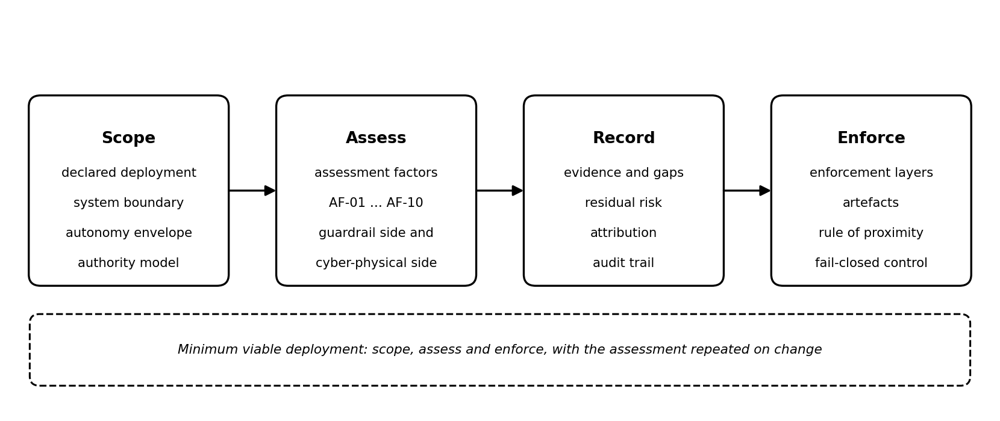
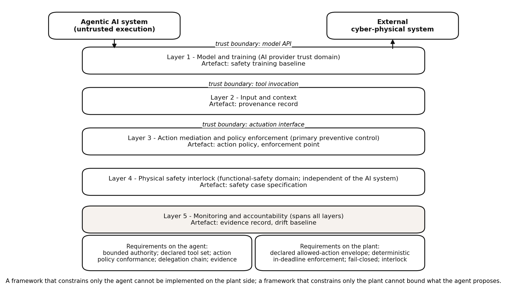
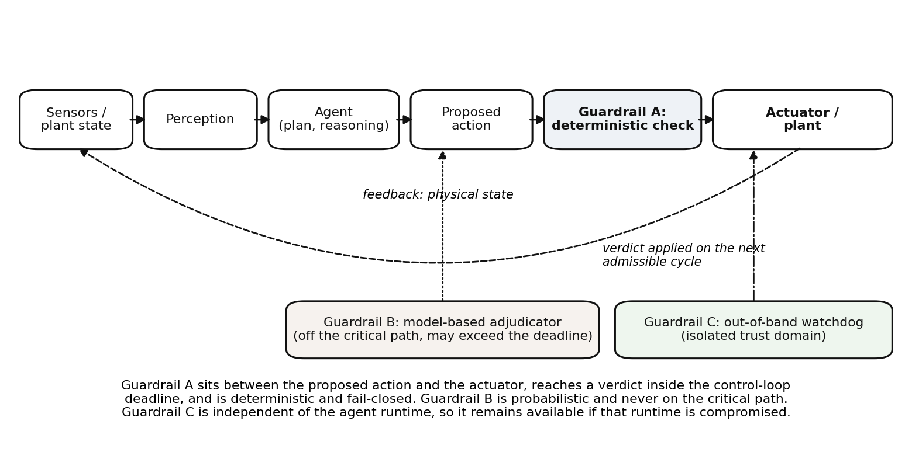
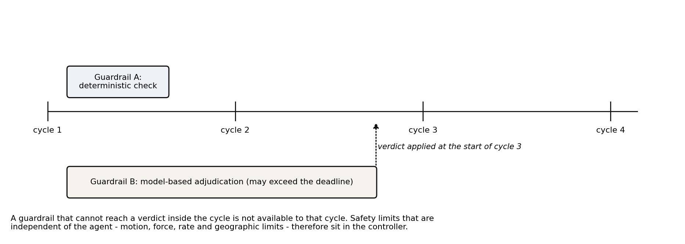

A general assessment framework for behavioural guardrails in cyber-physical systems
===================================================================================

This clause sets out a general assessment framework that the factors of clause 11 serve. It states the objectives of an assessment and the object it covers. It also states the enforcement layers and trust boundaries at which guardrails sit, and the rule that places authoritative control near the physical boundary. It then gives the artefacts an assessment requires, the roles and adoption conditions, and the minimum deployment that remains meaningful. Figure 2 shows the framework as a whole: the declared deployment is scoped, the guardrail chain is assessed against the factors, the result is recorded, and enforcement is placed accordingly.

    Figure 2 - The assessment framework: scope, assess, record and enforce

Objectives
----------

The framework places requirements on both sides of the boundary. It constrains the agentic AI system: its authority, tool set, action policy, delegation chain and evidence record. It also places requirements on the external cyber-physical system that receives the agent. These are a declared allowed-action envelope, a deterministic enforcement point available within the control-loop deadline, a failure default of refusal, and an independent safety interlock that remains effective when the agent is compromised. A framework that constrains only the agent cannot be implemented on the plant side. A framework that constrains only the plant cannot bound what the agent proposes. Both sides are required for the framework to be usable in deployment. The framework has four objectives. First, prevent unsafe actions before they reach the physical boundary. Second, ensure that every action is attributable to a specific agent identity and a specific policy decision. Third, enable safe intervention and recovery when prevention fails. Fourth, integrate with existing functional safety and security management systems rather than replacing them.

What the assessment covers
--------------------------

The object of assessment is the guardrail chain and its effect on the external cyber-physical system. The assessment addresses what the chain achieves at the boundary between the agentic AI system and the plant, rather than what the model computes internally. It therefore examines the guardrail chain as a deployed whole. This covers the policy enforcement points, the action mediation logic, the capability and credential regime, the egress controls, and the interlocks and the monitoring and accountability functions, together with the agentic system and the external cyber-physical system on which they act. The question posed is outcome-based, asking what reached the plant, what was prevented, what was contained and what was recovered, rather than which mechanism was installed or which technique was selected.

An assessment is scoped to a declared deployment. The declaration fixes the system boundary, the authority envelope within which the agent operates, the tool set and delegation chain in use, and the risk set drawn from clause 10 that the deployment is intended to bound. Two deployments that differ in any of these respects are assessed separately, since the same guardrail chain can be effective in one and ineffective in another.

The same declared deployment is assessed at design, at integration, in operation and after an incident, with the factors in clause 11 applied consistently across those occasions. The assessment complements and does not replace the functional-safety case; the agentic layer and its guardrails are additional to the established safety argument, and evidence gathered under this framework is not a substitute for the evidence that the functional-safety case requires.

Enforcement layers and trust boundaries
---------------------------------------

The framework defines five enforcement layers (figure 3), ordered by proximity to the physical boundary. Trust boundaries separate layers where the identity, authority, or integrity of the data changes.

    Figure 3 - Layers of system-facing guardrails and their artefacts

**Layer 1**: Model and Training. Inside the AI provider’s trust domain. Shaped by the provider’s safety training. Not under the integrator’s control.

Trust boundary: Model API. Data crossing this boundary is untrusted input to the integrator’s system.

**Layer 2**: Input and Context. Inside the integrator’s trust domain. It examines prompts and retrieved data before model processing. Provenance checks identify data from untrusted sources.

Trust boundary: Tool invocation. Data crossing this boundary is the agent’s proposed action.

**Layer 3**: Action Mediation and Policy Enforcement. Inside the integrator’s trusted computing base. It evaluates the proposed action against deterministic policy. This is the primary preventive control.

Trust boundary: Actuation interface. Commands crossing this boundary affect the physical plant.

**Layer 4**: Physical Safety Interlock. Inside the functional safety domain. It is independent of the AI system. It is deterministic and fail-safe. This is the last line of defence.

**Layer 5**: Monitoring and Accountability. It spans all layers. It collects evidence for detection, recovery, and audit.

Figure 4 shows where these guardrails sit in a cyber-physical control loop.

    Figure 4 - Placement of guardrails in a cyber-physical control loop

The rule of proximity
---------------------

The authoritative control sits closer to the physical boundary as the consequence of failure rises. For a read-only advisory agent, action mediation at Layer 3 may be sufficient. For an agent with write access to a controller, the physical safety interlock at Layer 4 is the authoritative constraint. The AI system cannot be trusted to enforce its own safety constraints when the consequence of failure is physical harm.

Integration with the functional safety case
-------------------------------------------

The behavioural guardrails for the AI agent are not a substitute for the functional safety case of the physical system. They are an additional layer. The safety case for the robot, vehicle, or industrial controller remains valid. The AI agent operates within the constraints of the safety case. If the AI agent proposes an action that would violate the safety case, the physical safety interlock rejects it. The integration point is the specification of the allowed action envelope. The AI agent is not permitted to command outside that envelope, regardless of its internal state.

Cyber-physical systems are already governed by functional-safety and security regimes. An agentic layer is integrated into the existing safety case rather than treated as a new control problem. Its authority is bounded by the system’s declared behaviour, its actions are mediated by the same enforcement point, and the evidence it produces is kept in the system’s record. Where the agent contributes to a safety function, the safety argument is required to state what the guardrail guarantees, what it does not, and what happens when it is unavailable.

Required artefacts
------------------

Four artefacts are required. The risk taxonomy identifies the threats specific to the deployment. The action policy specifies the permitted actions, targets, and conditions. The evidence record captures the state, the proposed action, the policy decision, and the outcome for every action. The delegation model specifies the agent’s identity, its delegated authority, the scope of that authority, and the chain of accountability.

Roles and accountability
------------------------

The AI provider is accountable for the model’s behaviour within its trust domain. The integrator is accountable for the enforcement layers it deploys and for the correctness of the action policy. The operator is accountable for the human oversight and intervention functions. The auditor is accountable for verifying that the evidence record is complete and that the enforcement layers operate as specified. Where an agent acts under delegated authority, the delegator is accountable for the scope of the delegation.

Adoption conditions
-------------------

The framework has: a clear specification of the allowed action envelope; a deterministic enforcement mechanism that operates within the control loop deadline; a fail-closed default; an evidence record that supports attribution; a delegation model that issues unique identities to agents; and integration with the existing safety case.

Summary of the enforcement layers and their artefacts
-----------------------------------------------------

Table 2 summarises the enforcement layers, their artefacts and failure modes.

.. list-table:: Table 2 - Enforcement layers, their artefacts and failure modes
    :header-rows: 1
    :widths: 27 24 23 25

    * - Layer
      - Function
      - Key artefact
      - Failure mode if absent
    * - Model and Training
      - Shape model propensity
      - Safety training data
      - Harmful output propensity
    * - Input and Context
      - Filter untrusted input
      - Provenance record
      - Prompt injection
    * - Action Mediation
      - Enforce policy on actions
      - Action policy
      - Unsafe action reaches plant
    * - Physical Safety Interlock
      - Deterministic last line
      - Safety case specification
      - Physical harm
    * - Monitoring and Accountability
      - Detect drift, enable audit
      - Evidence record
      - Unattributable failure

The layers and the artefacts that carry them are shown in Figure 3.

Deterministic, in-deadline and fail-closed enforcement
------------------------------------------------------

For actuating agents, enforcement is required to satisfy three properties. Deterministic: the same action and state always produce the same decision. In-deadline: the enforcement decision completes within the control loop period. Fail-closed: if the enforcement mechanism cannot render a decision, the action is denied. A guardrail that cannot be consulted is a guardrail that says no. This is the opposite of the default behaviour in many software systems, where an unavailable policy server might allow the action to proceed.

In a cyber-physical system the authoritative control is required to be available to the cycle in which the action is taken. A control that cannot reach a verdict inside the control-loop deadline is not available to that cycle at all. The enforcement point is therefore deterministic and local, and any model-based adjudicator is placed off the critical path, with its verdict applied on the next admissible cycle. The default on failure is refusal, not permission. Safety limits that are independent of the agent - motion, force, rate and geographic limits - belong in the controller rather than in the agent, so that they remain effective if the agent is compromised or the guardrail is bypassed. Figure 5 shows the timing relationship between the in-deadline decision and the off-critical-path adjudication.

    Figure 5 - Deterministic in-deadline control and off-critical-path adjudication

Placement across the lifecycle and the organisation
---------------------------------------------------

At design time the agent’s authority, tool set and limits are fixed. At integration the enforcement point is placed, the delegation model is established and the safety case is extended. At operation the trajectory is monitored, drift from the declared behaviour is detected and interventions are applied. After an incident the case is reconstructed from the evidence record and the policy is revised. Organisationally, the duties span the model provider, the integrator and the operator; the accountability model states which party owns the action policy and which party can halt the system.

Properties and cost of the enforcement mechanism
------------------------------------------------

Determinism
~~~~~~~~~~~

The enforcement layers that constrain physical action are deterministic. A probabilistic filter cannot guarantee that an unsafe action is blocked. The action mediation and physical safety interlock produce the same decision for the same inputs, every time. This is a hard requirement for actuating agents.

Timing
~~~~~~

Enforcement completes within the control loop deadline. The enforcement mechanism is selected and sized to fit the deadline. If it cannot, the action fails closed.

Certification
~~~~~~~~~~~~~

The framework is required to be compatible with existing certification regimes for functional safety and security. The AI agent is an additional component within the certified system. The certification evidence is required to include the action policy, the enforcement mechanism, and the evidence record. ISO/IEC 42001 [b-ISO/IEC 42001] provides a management system framework for AI that can be integrated with existing quality and safety management systems. The EU AI Act [b-EU AI Act]’s high-risk classification may apply to agents that act on physical systems.

Cost
~~~~

The cost of the framework is the engineering effort to specify the action policy correctly, to implement and verify the enforcement layers, and to maintain the evidence record. The cost of not deploying the framework is the risk of an unsafe action. For industrial deployments, the cost of a single unsafe action may exceed the cost of the framework by orders of magnitude.

Measurability
~~~~~~~~~~~~~

The framework is required to be measurable. The key metrics are: enforcement latency, decision accuracy (true positive and false positive rates for policy violations), evidence record completeness, and intervention time. These metrics are tracked during operation and reviewed periodically.

The factors against which the effectiveness of a guardrail deployment is assessed are set out in clause 11. Each factor is measured on the external cyber-physical system, not on the agent. Safety factors: the rate of unsafe actions that reach the plant; the residual risk after the physical safety interlock; the time to a safe state after a detected deviation; and the completeness of the safety argument for the agent's contribution to a safety function. Security factors: the rate of adversarially induced actions (prompt injection, tool poisoning, credential abuse) that reach the enforcement point; the proportion of actions taken under a verified identity and a valid delegation; the coverage of the tool and supply-chain inventory; and the time to revocation of a compromised agent identity. Deployment factors: the enforcement latency against the control-loop deadline; and the completeness of the evidence record. Each factor is reported with the confidence in its measurement, and a factor that cannot be measured is reported as not assessed rather than as satisfied.

Minimum viable deployment
-------------------------

An integrator can deploy a minimum viable version with three components. First, a read-only agent with no write access to the physical plant. This eliminates the risk of unsafe action while allowing the agent to provide diagnostic and advisory functions. Second, an action mediation layer that enforces a simple allow-list of permitted tool calls. Third, an evidence record that captures every tool call and its outcome. This version provides value and builds the operational experience needed for a more permissive deployment. The next increment would add write access with a deterministic safety interlock and human-in-the-loop approval for high-consequence actions.
